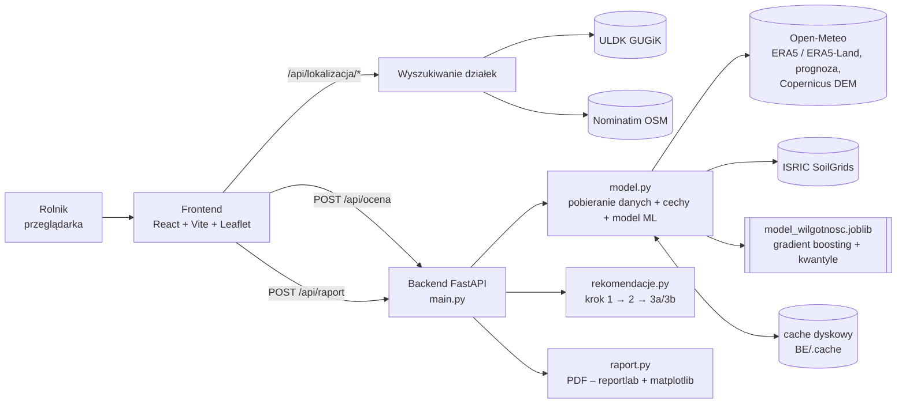

# Drought Predict – inteligentne wsparcie gospodarowania wodą na działce rolnej

> **Zespół:** _KN Neuron - Zatrzymaj Wodę, Chroń Plony_
> **Zadanie:** KOWR – „Zatrzymaj wodę, chroń plony” (HackNation 2026, Bydgoszcz, 21–22.11.2026)
> **Repozytorium:** https://github.com/33jarek/Hacknation2026 (prywatne)

Drought Predict to aplikacja webowa dla rolnika. Wskazujesz działkę: numer identyfikatora działki, adres albo punkt na mapie. Wybierasz uprawę i datę. Aplikacja pobiera dane pogodowe, glebowe i terenowe z ostatnich 10 lat i **własnym modelem uczenia maszynowego** ocenia stan wilgotności gleby. Na tej podstawie wylicza **sugestię dla uprawy**, a następnie **rekomendacje retencyjne, agrotechniczne i nawadniania**. Przy każdej rekomendacji podaje liczby, z których ona wynika. Wynik można pobrać jako **raport PDF**.

---

## Spis treści

1. [Zwięzły opis rozwiązania](#1-zwięzły-opis-rozwiązania)
2. [Instrukcja uruchomienia](#2-instrukcja-uruchomienia)
3. [Funkcjonalności](#3-funkcjonalności)
4. [Architektura](#4-architektura)
5. [Metodyka: jak liczony jest wynik i rekomendacje](#5-metodyka-jak-liczony-jest-wynik-i-rekomendacje)
6. [Źródła i zakresy danych](#6-źródła-i-zakresy-danych)
7. [Dane pobierane na bieżąco vs. przygotowane wcześniej](#7-dane-pobierane-na-bieżąco-vs-przygotowane-wcześniej)
8. [Biblioteki, komponenty, usługi i narzędzia AI](#8-biblioteki-komponenty-usługi-i-narzędzia-ai)
9. [Licencje i warunki korzystania](#9-licencje-i-warunki-korzystania)
10. [Weryfikacja wyników i rekomendacji](#10-weryfikacja-wyników-i-rekomendacji)
11. [Znane ograniczenia](#11-znane-ograniczenia)
12. [Skalowalność, koszty i bezpieczeństwo](#12-skalowalność-koszty-i-bezpieczeństwo)
13. [Zgodność z obowiązkowym zakresem prototypu](#13-zgodność-z-obowiązkowym-zakresem-prototypu-pkt-33)
14. [API](#14-api)
15. [Struktura repozytorium](#15-struktura-repozytorium)

---

## 1. Zwięzły opis rozwiązania

### Problem

Dane o suszy są dostępne: reanalizy klimatyczne, mapy glebowe, modele terenu, ewidencja działek. Są jednak rozproszone, techniczne i nie mówią rolnikowi, **co ma zrobić na swojej działce**. Rolnik nie wie, czy obecny niedobór wody to coś wyjątkowego, czy norma dla tej pory roku. Nie wie też, czy jego działka jest szczególnie podatna na suszę ani które działania (retencja, uprawa, nawadnianie) mają sens w jego warunkach.

### Główne funkcjonalności

- **Wybór działki bez znajomości GIS:** numer działki ewidencyjnej (ULDK GUGiK), adres albo kliknięcie na mapie. Działka jest rysowana na mapie razem z numerem, obrębem, gminą i powierzchnią.
- **Ocena stanu wilgotności (model AI):** gdzie dziś jest wilgotność gleby 0–100 cm na tle tej samej pory roku z ostatnich 10 lat (percentyl 0–100). Do tego przedział niepewności, trend z 7 dni i **prognoza na 7 dni**.
- **Historyczna podatność działki:** w ilu latach na 10 i w których miesiącach (IV–IX) występował niedobór.
- **Sugestia dla wybranej uprawy:** ocena zestawiona z wrażliwością uprawy i jej fazą krytyczną (np. kukurydza: wiechowanie w VII–VIII).
- **Rekomendacje retencyjne, agrotechniczne i nawadniania.** Każda rekomendacja wynika z oceny stanu wilgotności działki i z przyczyn niedoboru wskazanych przez model AI.
- **Przyczyny:** czynniki, które w danej chwili najbardziej odbiegają od normy, np. bilans wodny, dni bez opadu, temperatura, pojemność wodna gleby.
- **Raport PDF** gotowy do zapisania lub wydruku. Zawiera stan, przyczyny, rekomendacje, datę, źródła danych, metodykę i ograniczenia.

### Sposób wykorzystania danych

Na każde zapytanie aplikacja pobiera dla wskazanego punktu:

- 10 lat dziennych danych meteorologicznych i wilgotności gleby (ERA5 / ERA5-Land przez Open-Meteo);
- właściwości gleby (ISRIC SoilGrids);
- wysokości terenu (Copernicus DEM).

Z tych danych liczy cechy, m.in. bilans wodny P − ET0 w oknach 7–90 dni, odchylenia od normy sezonowej, pojemność wodną gleby i spadek terenu. Model ML ocenia na ich podstawie **każdy dzień z 10 lat**. Daje to i ocenę bieżącą, i historyczną podatność. Rekomendacje powstają z wyniku modelu według jawnych reguł opartych na wiedzy agronomicznej.

### Korzyści dla użytkownika

- Odpowiedź na pytanie „czy u mnie jest sucho **jak na tę porę roku**?” zamiast surowych liczb.
- Rekomendacje dopasowane do działki: gleby, spadku terenu, podatności i uprawy. Do każdej podane jest uzasadnienie.
- Uczciwa informacja o niepewności i brakach danych. Aplikacja nie udaje precyzji.
- Raport PDF do dokumentacji gospodarstwa lub rozmowy z doradcą.

---

## 2. Instrukcja uruchomienia

Aplikacja składa się z dwóch części: **backendu** (Python, FastAPI, port 8000) i **frontendu** (React + Vite, port 5173). Frontend przekazuje zapytania `/api/*` do backendu, więc wystarczy otworzyć `http://localhost:5173`.

### Wymagania

| Narzędzie | Wersja                             | Uwagi                                          |
| --------- | ---------------------------------- | ---------------------------------------------- |
| Python    | **3.12** (min. 3.11)               | testowane na 3.12.16                           |
| Node.js   | **22 LTS lub nowszy** (min. 20.19) | testowane na 26.12                             |
| Internet  | wymagany                           | dane są pobierane na bieżąco z publicznych API |

Przeglądarki: Chrome, Firefox, Edge, Safari, Opera. Nie trzeba niczego instalować po stronie użytkownika.

### Windows (PowerShell)

```powershell
# 1) Backend – w pierwszym oknie terminala
cd BE
py -3.12 -m venv .venv
.\.venv\Scripts\Activate.ps1
pip install -r requirements.txt
python run.py                      # -> http://localhost:8000  (dokumentacja API: /docs)

# 2) Frontend – w drugim oknie terminala
cd FE
npm install
npm run dev                        # -> http://localhost:5173
```

> Jeśli PowerShell blokuje aktywację środowiska: `Set-ExecutionPolicy -Scope Process -ExecutionPolicy Bypass`.

### macOS / Linux

```bash
# Backend
cd BE
python3.12 -m venv .venv
source .venv/bin/activate
pip install -r requirements.txt
python run.py

# Frontend (drugi terminal)
cd FE
npm install
npm run dev
```

### Pierwsza analiza (ok. 1 minuta)

1. Otwórz `http://localhost:5173`.
2. Wyszukaj działkę:
   - zakładka **Nr działki**, np. `141201_1.0001.6509` albo „obręb + numer”, np. `Krzyki 33/1`;
   - zakładka **Adres**;
   - albo **kliknij na mapie**.
3. Wybierz **uprawę** i **datę analizy** (ostatnie 10 lat, do dziś).
4. Kliknij **Analizuj**. Pierwsze zapytanie dla nowej lokalizacji trwa zwykle 7–20 s, bo pobierane jest 10 lat danych. Kolejne korzystają z cache.
5. Kliknij **Pobierz raport PDF**.

### Konfiguracja opcjonalna

- `VITE_API_URL`: adres backendu, gdy frontend i backend działają pod różnymi adresami, np. `VITE_API_URL=https://api.example.pl npm run build`. Domyślnie frontend używa `/api` przez proxy Vite.
- Wersja produkcyjna frontendu: `npm run build`. Statyczne pliki trafiają do `FE/dist`.

### Ponowne wytrenowanie modelu (niewymagane do uruchomienia)

Wytrenowany model jest w repozytorium (`BE/model_wilgotnosc.joblib`).

```bash
cd BE
python model.py                       # pobiera dane treningowe z Open-Meteo/SoilGrids i trenuje
python model.py dane/train.parquet    # trenuje z gotowego pliku, bez pobierania
```

Wynik: model, metadane z metrykami (`model_wilgotnosc_meta.json`) i wykres diagnostyczny (`wykresy/ocena_modelu.png`).

---

## 3. Funkcjonalności

### 3.1. Wskazanie działki

| Sposób                  | Jak działa                                                                                                                     | Źródło                                            |
| ----------------------- | ------------------------------------------------------------------------------------------------------------------------------ | ------------------------------------------------- |
| **Numer działki**       | pełny identyfikator TERYT (`141201_1.0001.6509`) lub „obręb + numer” (`Krzyki 33/1`) → geometria działki, środek, powierzchnia | ULDK GUGiK (`GetParcelById`, `GetParcelByIdOrNr`) |
| **Adres**               | geokodowanie adresu → punkt → działka w tym punkcie                                                                            | Nominatim (OSM) + ULDK                            |
| **Kliknięcie na mapie** | punkt → działka w tym punkcie + nazwa miejscowości                                                                             | ULDK (`GetParcelByXY`) + Nominatim reverse        |
| **Współrzędne**         | np. `52.2297, 21.0122` (kolejność i przecinki dziesiętne rozpoznawane automatycznie)                                           | –                                                 |

Mapa (Leaflet) ma podkład OpenStreetMap, **ortofotomapę Geoportalu** i warstwę **granic działek** z Krajowej Integracji Ewidencji Gruntów (widoczną od zoomu 15). Gdy usługa ULDK jest niedostępna, analiza i tak działa dla wskazanego punktu. Użytkownik widzi wtedy wprost komunikat, że obrysu działki nie udało się pobrać.

### 3.2. Wynik analizy (ekran i raport)

1. **Stan wilgotności (krok 1):**
   - klasa: silny niedobór / niedobór / norma / wilgotno;
   - percentyl wilgotności;
   - przedział niepewności Q10–Q90;
   - pewność rozpoznania niedoboru;
   - zmiana w ostatnich 7 dniach;
   - **prognoza na 7 dni**.
2. **Sugestia dla uprawy (krok 2):** poziom ryzyka dla wybranej uprawy z uwzględnieniem fazy krytycznej i okresu wegetacji.
3. **Wykres z ostatnich 7 dni:** ocena modelu, wartość referencyjna ERA5 i przedział niepewności.
4. **Warunki przed dniem analizy:** średnia temperatura maksymalna z 14 dni, opady z 30 dni, objętościowa zawartość wody w glebie 0–100 cm.
5. **Podatność działki (10 lat):** odsetek lat z niedoborem w sezonie IV–IX i miesiące najczęstszego niedoboru.
6. **Co wpływa na wilgotność:** czynniki posortowane według odchylenia od normy.
7. **Rekomendacje retencyjne (krok 3a)** oraz **agrotechniczne i nawadniania (krok 3b)**. Każda ma priorytet (Pilne / Polecane / Długoterminowe) i uzasadnienie liczbowe.
8. **Raport PDF** (przycisk „Pobierz raport PDF”, 2 strony A4).

### 3.3. Obsługa błędów i braków danych

- Brak danych glebowych, np. w terenie zabudowanym, wyłącza rekomendacje glebowe. Raport mówi to wprost: „Brak danych glebowych (SoilGrids) – ocena mniej pewna”, a dawka nawadniania jest oznaczona jako orientacyjna.
- Opóźnienie ERA5 (ok. 5 dni) jest komunikowane: „Dane meteo dostępne do …”.
- Limit zapytań Open-Meteo daje czytelny komunikat w ciągu ok. 0,3 s zamiast zawieszenia aplikacji.
- Niedostępność ULDK: analiza działa dalej dla punktu, a aplikacja przez 2 minuty nie odpytuje ponownie zablokowanej usługi.

---

## 4. Architektura



| Warstwa      | Pliki                                                            | Odpowiedzialność                                                      |
| ------------ | ---------------------------------------------------------------- | --------------------------------------------------------------------- |
| Frontend     | `FE/src/routes/index.tsx`, `FE/src/components/dashboard/*`       | formularz, mapa, karty wyników, wykres, pobranie PDF                  |
|              | `FE/src/hooks/useOcenaWilgoci.ts`, `FE/src/hooks/lokalizacja.ts` | komunikacja z API (TanStack Query)                                    |
| API          | `BE/main.py`                                                     | endpointy, walidacja wejścia (Pydantic), składanie odpowiedzi         |
| Dane + model | `BE/model.py`                                                    | pobieranie danych, inżynieria cech, trening, `ocen()`, prognoza 7 dni |
| Rekomendacje | `BE/rekomendacje.py`                                             | łańcuch krok 1 → krok 2 → krok 3a/3b (czyste funkcje)                 |
| Raport       | `BE/raport.py`                                                   | generowanie PDF                                                       |
| Działki      | `BE/services/data_sources/parcel.py`                             | ULDK, Nominatim, parsowanie geometrii WKT                             |
| HTTP/cache   | `BE/services/data_sources/http.py`, `_get()` w `model.py`        | zapytania z ponawianiem i cache na dysku                              |

> `BE/app.py` (Flask) oraz `BE/services/scoring`, `BE/services/report` i moduły `satellite.py`, `hydro.py`, `terrain.py`, `soil.py` to **wcześniejszy prototyp, nieużywany przez obecną aplikację**. Opisujemy je w [Znanych ograniczeniach](#11-znane-ograniczenia).

---

## 5. Metodyka: jak liczony jest wynik i rekomendacje

### 5.1. Co dokładnie oceniamy

Celem jest **percentyl wilgotności gleby w strefie korzeniowej 0–100 cm** na tle tej samej pory roku (±7 dni) z wielolecia:

- 0 to najsuchszy taki dzień w historii;
- 50 to warunki typowe;
- 100 to najmokrzejszy.

Wilgotność 0–100 cm to średnia ważona grubością warstw ERA5-Land: 0–7 cm, 7–28 cm i 28–100 cm.

Takie podejście (anomalia wilgotności gleby względem klimatologii) stosują systemy monitoringu suszy rolniczej, np. wskaźnik anomalii wilgotności gleby w Europejskim Obserwatorium Suszy (EDO). Percentyl mówi rolnikowi, czy jest sucho **jak na tę porę roku**. Sama objętość wody tego nie mówi, bo zależy od gleby.

Progi klas: **< 10** silny niedobór, **< 30** niedobór, **30–70** norma, **> 70** wilgotno.

### 5.2. Cechy wejściowe modelu (29)

- **Bilans wodny i opady:** sumy opadu, ewapotranspiracji wskaźnikowej ET0 (FAO-56, Penman-Monteith) i bilansu P − ET0 w oknach 7, 30, 60 i 90 dni.
- **Odchylenia sezonowe:** standaryzowane odchylenia bilansu (30/60/90 dni) od normy dla tej pory roku. To uproszczony odpowiednik wskaźnika SPEI.
- **Temperatura i opady:** średnia temperatura maksymalna z 14 dni, liczba dni od ostatniego opadu ≥ 5 mm, sezonowość (sin/cos dnia roku).
- **Gleba (SoilGrids, 0–30 cm):** udział iłu i piasku, węgiel organiczny oraz **pojemność wodna 0–100 cm**, czyli różnica między polową pojemnością wodną a punktem trwałego więdnięcia. Liczona funkcjami pedotransferowymi Saxton & Rawls (2006).
- **Teren (Copernicus DEM):** wysokość, spadek (z 4 punktów ±150 m) i położenie względem otoczenia (wzniesienie / obniżenie).
- **Ostatni znany stan wilgotności** sprzed 7, 14 i 28 dni (ERA5-Land).

Wszystkie cechy dla danego dnia liczone są **wyłącznie z danych z tego dnia i wcześniejszych**, bez „podglądania przyszłości”.

### 5.3. Model

- **Algorytm:** `HistGradientBoostingRegressor` (scikit-learn). Model uczy się **dynamiki**, czyli tego, jak pogoda z ostatniego tygodnia, gleba i teren zmieniają stan wilgotności względem ostatniego znanego stanu.
- **Niepewność:** dwa modele kwantylowe (10. i 90. percentyl) plus **kalibracja konformalna** (conformalized quantile regression, Romano i in., 2019) na roku 2022. Dzięki temu przedział Q10–Q90 rzeczywiście obejmuje ok. 80% przypadków.
- **Prognoza na 7 dni:** ten sam model zasilony pogodą na kolejne 7 dni. Dla dat historycznych są to obserwacje z archiwum, dla dat bieżących prognoza Open-Meteo. Źródło pogody jest podane w wyniku.
- **Podatność 10-letnia:** model ocenia każdy dzień z 10 lat. Dla każdego miesiąca IV–IX liczony jest odsetek lat, w których średnia ocena wynosiła < 30.

### 5.4. Dane treningowe i jakość

- **Dane:** 44 punkty losowane z siatki 0,5° w obrysie Polski, lata 2016–2025, próbki co 7 dni w miesiącach III–X, ok. 15 400 wierszy.
- **Walidacja czasowa:** trening na latach 2016–2022, test na **2023–2025**. Tych lat model nie widział.

| Model (lata testowe 2023–2025)                        | Średni błąd [pkt] | R²       | Trafność „niedobór tak/nie” | Zgodność 4 klas | Błąd ≤ 15 pkt |
| ----------------------------------------------------- | ----------------- | -------- | --------------------------- | --------------- | ------------- |
| Persystencja („jak tydzień temu”) – punkt odniesienia | 12,6              | 0,64     | 83%                         | 63%             | 68%           |
| Model v1 (tylko pogoda, gleba, teren)                 | 20,3              | 0,17     | 70%                         | 44%             | 46%           |
| Regresja grzbietowa (Ridge)                           | 9,9               | 0,79     | 87%                         | 68%             | 78%           |
| **Gradient boosting (używany)**                       | **9,6**           | **0,79** | **87%**                     | **69%**         | **80%**       |

- **Przedział Q10–Q90:** pokrycie na latach testowych **79,5%** (cel 80%).
- **Średni błąd według lat:** 2023: 9,1; 2024: 9,1; 2025: 10,6.
- **Średni błąd według gleby:** ciężka 9,7; średnia 9,3; lekka 9,8. Model nie jest stronniczy względem typu gleby.
- **Najważniejsze cechy** (permutation importance): stan sprzed 7 dni, ET0 z 7 dni, bilans z 7 dni, opad z 7 dni.

Pełne metryki: `BE/model_wilgotnosc_meta.json`. Wykres rzeczywistość vs. predykcja: `BE/wykresy/ocena_modelu.png`.

### 5.5. Rekomendacje: łańcuch wnioskowania (`BE/rekomendacje.py`)

Zgodnie z wymogiem regulaminu **kolejność ma znaczenie**. Każdy krok korzysta z wyniku poprzedniego, a bez kroku 1 rekomendacje nie powstają.

```
KROK 1  Ocena AI       percentyl + przedział Q10–Q90 + trend 7 dni + prognoza 7 dni
                        → stan, pewność rozpoznania niedoboru
KROK 2  Sugestia       wynik kroku 1 × uprawa (wrażliwość, faza krytyczna, okres wegetacji)
                        → ryzyko dla uprawy: wysokie / umiarkowane / niskie / nadmiar wody
KROK 3a Retencja       ryzyko z kroku 2 + podatność 10 lat + gleba + teren
                        → działania długofalowe (gdzie i jak zatrzymać wodę)
KROK 3b Agrotechnika   ryzyko z kroku 2 + bieżące przyczyny (bilans, dni bez opadu, temperatura)
        i nawadnianie   → działania teraz, w tym zasadność, termin i dawka nawadniania
```

**Krok 1, pewność.** Wynika z położenia przedziału Q10–Q90 względem progu niedoboru (30):

- cały przedział poniżej progu: „niedobór pewny”;
- przedział przecina próg: „prawdopodobny” albo „możliwy”;
- cały przedział powyżej progu: „mało prawdopodobny”.

**Krok 2, profil uprawy.**

- Próg niedoboru dla uprawy wynosi `30 + (wrażliwość − 0,6) × 25`, a w fazie krytycznej jest dodatkowo podnoszony o 5.
- Jeśli prognoza na 7 dni jest wyraźnie gorsza od stanu bieżącego, ryzyko liczone jest z prognozy, żeby rolnik mógł działać z wyprzedzeniem.
- Poza okresem wegetacji uprawy rekomendacje dotyczą odbudowy zapasu wody.

| Uprawa                  | Wrażliwość | Okres krytyczny | Faza                              |
| ----------------------- | ---------- | --------------- | --------------------------------- |
| Zboża ozime             | 0,55       | V–VI            | strzelanie w źdźbło, kłoszenie    |
| Zboża jare              | 0,60       | V–VI            | strzelanie w źdźbło, kłoszenie    |
| Kukurydza               | 0,80       | VII–VIII        | wiechowanie, kwitnienie           |
| Rzepak i rzepik         | 0,68       | IV–V            | kwitnienie, zawiązywanie łuszczyn |
| Burak cukrowy           | 0,78       | VII–VIII        | przyrost korzenia                 |
| Ziemniaki               | 0,82       | VI–VII          | zawiązywanie i przyrost bulw      |
| Rośliny strączkowe      | 0,70       | VI–VII          | kwitnienie, zawiązywanie strąków  |
| Użytki zielone          | 0,60       | V–VIII          | odrastanie po pokosach            |
| Drzewa i krzewy owocowe | 0,72       | V–VII           | zawiązywanie i wzrost owoców      |

**Krok 3a, przykłady reguł retencyjnych** (każda podaje liczby w „Na podstawie”):

- piasek ≥ 55%, pojemność wodna < 130 mm lub węgiel organiczny < 10 g/kg → zwiększanie materii organicznej (obornik, kompost, słoma, międzyplony);
- spadek ≥ 2% → uprawa w poprzek stoku, pasy buforowe, okrywa roślinna;
- działka ≥ 1 m poniżej otoczenia → mała retencja (oczko wodne, zbiornik, zastawka);
- teren płaski i działka podatna na suszę → zatrzymywanie wody w rowach melioracyjnych (zastawki, współpraca ze spółką wodną);
- nadmiar wody → zatrzymanie nadwyżki zamiast szybkiego odprowadzania.

**Krok 3b, przykłady reguł agrotechnicznych i nawadniania:**

- ryzyko wysokie lub umiarkowane → ograniczenie parowania (mulcz, rezygnacja z orki), odchwaszczanie, odłożenie pogłównego nawożenia azotem;
- ryzyko wysokie → **nawadnianie**: priorytet „Pilne” w fazie krytycznej. Dawka to `0,25 × pojemność wodna gleby` w granicach 15–35 mm; na glebach lekkich mniejsze dawki, częściej; podlewanie wieczorem lub rano;
- ryzyko umiarkowane → najpierw **sprawdzenie wilgotności w polu**, dopiero potem decyzja o nawadnianiu;
- nadmiar wody → ostrzeżenie przed ugniataniem gleby i chorobami grzybowymi;
- poza sezonem → okrywa zimowa, retencja wody z roztopów.

> Rekomendacje są **deterministyczne i jawne**. Nie używamy modelu generatywnego (LLM), więc te same dane zawsze dają te same zalecenia, a każde można sprawdzić.

### 5.6. Podstawy naukowe (wybór)

- Allen R.G. i in. (1998). _Crop evapotranspiration – FAO Irrigation and Drainage Paper 56_. FAO. ET0 metodą Penmana-Monteitha.
- Vicente-Serrano S.M., Beguería S., López-Moreno J.I. (2010). A Multiscalar Drought Index Sensitive to Global Warming: The SPEI. _Journal of Climate_. Standaryzowany bilans P − ET0.
- Saxton K.E., Rawls W.J. (2006). Soil Water Characteristic Estimates by Texture and Organic Matter for Hydrologic Solutions. _SSSAJ_. Pojemność wodna gleby.
- Muñoz-Sabater J. i in. (2021). ERA5-Land: a state-of-the-art global reanalysis dataset for land applications. _Earth System Science Data_.
- Hersbach H. i in. (2020). The ERA5 global reanalysis. _QJRMS_.
- Poggio L. i in. (2021). SoilGrids 2.0: producing soil information for the globe with quantified spatial uncertainty. _SOIL_.
- Romano Y., Patterson E., Candès E. (2019). Conformalized Quantile Regression. _NeurIPS_. Kalibracja przedziału niepewności.
- European Drought Observatory (Copernicus EMS): wskaźniki anomalii wilgotności gleby jako podstawa monitoringu suszy rolniczej.

---

## 6. Źródła i zakresy danych

| Kategoria                    | Źródło                                                  | Co pobieramy                                                                     | Zakres / rozdzielczość                                                            | Gdzie w kodzie                                                     |
| ---------------------------- | ------------------------------------------------------- | -------------------------------------------------------------------------------- | --------------------------------------------------------------------------------- | ------------------------------------------------------------------ |
| Meteorologiczne              | **Open-Meteo Historical Weather API** (ERA5, ERA5-Land) | dzienne: opad, ET0 (FAO), Tmax; godzinowe: wilgotność gleby 0–7, 7–28, 28–100 cm | **10 lat + 120 dni** przed datą analizy; siatka ok. 9–25 km; opóźnienie ok. 5 dni | `model.py: pobierz_meteo`                                          |
| Meteorologiczne (prognoza)   | **Open-Meteo Forecast API**                             | dzienne: opad, ET0, Tmax (ostatnie 92 dni + do 16 dni prognozy)                  | dla dat, których nie ma jeszcze w archiwum                                        | `model.py: pobierz_pogode_dni`, `services/data_sources/weather.py` |
| Wilgotność gleby (reanaliza) | **ERA5-Land** (Copernicus C3S, przez Open-Meteo)        | wilgotność 0–100 cm: cel modelu i wartość referencyjna                           | jw.                                                                               | `model.py`                                                         |
| Glebowe                      | **ISRIC SoilGrids v2.0** (REST API)                     | ił, piasek, węgiel organiczny, warstwy 0–5, 5–15, 15–30, 30–60, 60–100 cm        | rozdzielczość 250 m                                                               | `model.py: pobierz_glebe`                                          |
| Ukształtowanie terenu        | **Open-Meteo Elevation API** (Copernicus DEM GLO-90)    | wysokość w 5 punktach: środek i ±150 m                                           | ok. 90 m                                                                          | `model.py: pobierz_teren`                                          |
| Działki ewidencyjne          | **ULDK GUGiK**                                          | identyfikator, numer, obręb, gmina, powiat, województwo, geometria (WGS84)       | cała Polska                                                                       | `services/data_sources/parcel.py`                                  |
| Adresy                       | **Nominatim (OpenStreetMap)**                           | geokodowanie adresu i nazwy miejsc                                               | cała Polska                                                                       | `parcel.py: geocode_address, reverse_geocode`                      |
| Mapa: podkład                | **OpenStreetMap** (kafelki)                             | podkład mapy                                                                     | –                                                                                 | `MapaPolski.tsx`                                                   |
| Mapa: zdjęcia lotnicze       | **Geoportal.gov.pl – ortofotomapa (WMS)**               | warstwa do wyboru na mapie (podgląd)                                             | –                                                                                 | `MapaPolski.tsx`                                                   |
| Mapa: granice działek        | **GUGiK – Krajowa Integracja Ewidencji Gruntów (WMS)**  | warstwa granic i numerów działek (podgląd)                                       | od zoomu 15                                                                       | `MapaPolski.tsx`                                                   |

Kategorie danych satelitarnych i hydrologicznych są pokryte tylko częściowo. Szczegóły w punkcie 11.

---

## 7. Dane pobierane na bieżąco vs. przygotowane wcześniej

**Wynik i rekomendacje oblicza aplikacja w chwili zapytania.** Nic nie jest wyświetlane z gotowych odpowiedzi.

| Dane                                                               | Tryb                                                                                                | Data pobrania / przetworzenia                                                                                                                               |
| ------------------------------------------------------------------ | --------------------------------------------------------------------------------------------------- | ----------------------------------------------------------------------------------------------------------------------------------------------------------- |
| Pogoda, wilgotność gleby (10 lat), gleba, teren, działka, adres    | **na bieżąco** przy każdej analizie dla nowej lokalizacji i daty                                    | w chwili zapytania                                                                                                                                          |
| Prognoza pogody (prognoza +7 dni dla dat bieżących)                | **na bieżąco**, cache ważny 1 dzień                                                                 | w chwili zapytania                                                                                                                                          |
| Kafelki mapy, ortofotomapa, granice działek (WMS)                  | **na bieżąco** w przeglądarce                                                                       | w chwili wyświetlenia                                                                                                                                       |
| **Model ML** (`BE/model_wilgotnosc.joblib`)                        | przygotowany wcześniej                                                                              | dane treningowe pobrane **21.11.2026** (Open-Meteo ERA5/ERA5-Land 2015–2025, SoilGrids, Copernicus DEM dla 44 punktów); model v2 wytrenowany **22.11.2026** |
| Poprzednia wersja modelu (`model_wilgotnosc_v1.joblib`)            | archiwalna, nieużywana                                                                              | 21.11.2026                                                                                                                                                  |
| **Cache odpowiedzi API** (`BE/.cache/openmeteo`, `BE/.cache/http`) | zapis odpowiedzi z wcześniejszych zapytań, przyspiesza ponowne analizy tej samej lokalizacji i daty | 21–22.11.2026. Aplikacja działa także bez cache, wtedy pobiera wszystko na nowo.                                                                            |

Cache archiwalnych danych pogodowych nie wygasa, bo dane historyczne się nie zmieniają. Cache ULDK i Nominatim ma ważność 7–30 dni. Usunięcie katalogu `BE/.cache` wymusza pełne pobranie.

Gotowe wyniki analiz (`/api/ocena`, także dla raportu PDF) trafiają do `BE/.cache/ocena`. Trzymanych jest najwyżej **5 rekordów**, każdy ważny **4 godziny**. Rekord to współrzędne (zaokrąglone do ok. 11 m), data analizy i uprawa. Przy przekroczeniu limitu usuwany jest najstarszy wpis. Ten katalog nie jest commitowany.

---

## 8. Biblioteki, komponenty, usługi i narzędzia AI

### Backend (Python, `BE/requirements.txt`)

| Biblioteka                          | Wersja  | Zastosowanie                                          | Licencja                            |
| ----------------------------------- | ------- | ----------------------------------------------------- | ----------------------------------- |
| FastAPI (+ Pydantic, Starlette)     | 0.165.0 | API, walidacja wejścia                                | MIT                                 |
| Uvicorn                             | 0.54.0  | serwer ASGI                                           | BSD-3-Clause                        |
| scikit-learn                        | 1.9.1   | model ML (gradient boosting, kwantyle, Ridge)         | BSD-3-Clause                        |
| NumPy                               | 2.4.6   | obliczenia                                            | BSD-3-Clause                        |
| pandas                              | 3.0.6   | szeregi czasowe, cechy                                | BSD-3-Clause                        |
| SciPy                               | 1.18.1  | statystyka (regresja diagnostyczna, rozkład normalny) | BSD-3-Clause                        |
| joblib                              | 1.6.0   | zapis i odczyt modelu                                 | BSD-3-Clause                        |
| Matplotlib                          | 3.11.2  | wykres w raporcie PDF, wykresy diagnostyczne          | Matplotlib License (BSD-compatible) |
| ReportLab                           | 5.1.0   | generowanie PDF                                       | BSD                                 |
| requests                            | 2.34.2  | zapytania HTTP                                        | Apache-2.0                          |
| PyArrow                             | 26.0.1  | odczyt i zapis Parquet (dane treningowe)              | Apache-2.0                          |
| Flask                               | 3.0.3   | wyłącznie stary prototyp `app.py` (nieużywany)        | BSD-3-Clause                        |
| Czcionka DejaVu Sans (z Matplotlib) | –       | polskie znaki w PDF                                   | Bitstream Vera / DejaVu (wolna)     |

### Frontend (`FE/package.json`)

| Biblioteka                            | Wersja              | Zastosowanie                       | Licencja                  |
| ------------------------------------- | ------------------- | ---------------------------------- | ------------------------- |
| React, React DOM                      | 19.3                | interfejs                          | MIT                       |
| TanStack Router / Query / Charts      | 1.170 / 5.108 / 1.5 | routing, pobieranie danych, wykres | MIT                       |
| Leaflet                               | 1.9.4               | mapa interaktywna                  | BSD-2-Clause              |
| Tailwind CSS                          | 4.3                 | style                              | MIT                       |
| Vite, @vitejs/plugin-react            | 8.3 / 6.1           | budowanie i serwer deweloperski    | MIT                       |
| TypeScript                            | 7.0                 | typowanie                          | Apache-2.0                |
| oxlint                                | 1.90                | lintowanie                         | MIT                       |
| Czcionka Inter (`FE/fonts/Inter.ttf`) | –                   | typografia                         | SIL Open Font License 1.1 |

### Usługi zewnętrzne (API)

Open-Meteo (Historical Weather, Forecast, Elevation), ISRIC SoilGrids REST, ULDK GUGiK, Nominatim OSM, kafelki OpenStreetMap, Geoportal WMS (ortofotomapa), GUGiK KIEG WMS. **Wszystkie są bezpłatne i nie wymagają klucza API.**

### Sztuczna inteligencja: zakres i sposób użycia

| Element                                                 | Rodzaj                                                                                                                         | Rola                                                                                                                        |
| ------------------------------------------------------- | ------------------------------------------------------------------------------------------------------------------------------ | --------------------------------------------------------------------------------------------------------------------------- |
| **Model oceny wilgotności** (`model_wilgotnosc.joblib`) | uczenie maszynowe: gradient boosting + regresja kwantylowa z kalibracją konformalną, **opracowany i wytrenowany przez zespół** | ocena stanu wilgotności (krok 1), przedział niepewności, prognoza 7 dni, podatność 10-letnia                                |
| Silnik rekomendacji (`rekomendacje.py`)                 | **reguły eksperckie, nie AI generatywna**                                                                                      | kroki 2, 3a, 3b. Wynik jest deterministyczny i ma jawne uzasadnienie.                                                       |
| Narzędzia AI przy tworzeniu kodu                        | Claude Code (Anthropic), asystent programistyczny                                                                              | pomoc przy pisaniu i refaktoryzacji kodu, dokumentacji i eksperymentach z modelem. _[Zespół: dopisać inne użyte narzędzia]_ |

W działającej aplikacji **nie są wywoływane żadne zewnętrzne modele AI ani LLM**. Cała inferencja odbywa się lokalnie na backendzie.

---

## 9. Licencje i warunki korzystania

| Dane / usługa                            | Licencja / warunki                                                                                                                                                                                    | Jak spełniamy                                                                                    |
| ---------------------------------------- | ----------------------------------------------------------------------------------------------------------------------------------------------------------------------------------------------------- | ------------------------------------------------------------------------------------------------ |
| Open-Meteo (API)                         | dane **CC BY 4.0**; API bezpłatne do **użytku niekomercyjnego** w limitach (ok. 10 000 zapytań/dzień, 5 000/h, 600/min). Użycie komercyjne wymaga planu płatnego lub własnej instancji (open source). | przypis źródła w raporcie; cache ogranicza liczbę zapytań                                        |
| ERA5 / ERA5-Land (Copernicus C3S, ECMWF) | licencja Copernicus: bezpłatne użycie z przypisaniem („Contains modified Copernicus Climate Change Service information”)                                                                              | źródło podane w raporcie i README                                                                |
| Copernicus DEM GLO-90                    | licencja Copernicus DEM, bezpłatna, wymaga przypisania (© DLR e.V., © Airbus Defence and Space GmbH, w ramach programu Copernicus)                                                                    | przypis w raporcie                                                                               |
| ISRIC SoilGrids v2.0                     | **CC BY 4.0**                                                                                                                                                                                         | przypis w raporcie                                                                               |
| ULDK, Geoportal WMS, KIEG (GUGiK)        | publiczne usługi GUGiK, dane udostępniane nieodpłatnie zgodnie z ustawą Prawo geodezyjne i kartograficzne                                                                                             | atrybucja na mapie; cache 30 dni; ograniczenie zapytań po błędzie                                |
| Nominatim (OSM)                          | dane **ODbL**; [Usage Policy](https://operations.osmfoundation.org/policies/nominatim/): maks. 1 zapytanie/s, identyfikujący User-Agent, bez masowego geokodowania                                    | pojedyncze zapytania na akcję użytkownika, cache 7–30 dni, User-Agent aplikacji                  |
| Kafelki OpenStreetMap                    | dane **ODbL**, [Tile Usage Policy](https://operations.osmfoundation.org/policies/tiles/)                                                                                                              | atrybucja na mapie. W produkcji należy użyć własnego serwera kafelków lub komercyjnego dostawcy. |
| Biblioteki                               | MIT / BSD / Apache-2.0 / OFL (tabele w pkt 8)                                                                                                                                                         | licencje permisywne, zgodne z użyciem w prototypie                                               |

---

## 10. Weryfikacja wyników i rekomendacji

1. **Walidacja modelu na latach niewidzianych w treningu (2023–2025).** Metryki są w pkt 5.4 i w `model_wilgotnosc_meta.json`. Uruchomienie `python model.py` odtwarza trening i wypisuje wszystkie metryki.
2. **Porównanie z punktem odniesienia.** Model bije prognozę naiwną „będzie jak tydzień temu” (błąd 9,6 vs 12,6; R² 0,79 vs 0,64). Wiadomo więc, że faktycznie czegoś się nauczył.
3. **Kontrola w każdej analizie.** Na wykresie obok oceny modelu jest linia **ERA5**, czyli wartość referencyjna z reanalizy. Użytkownik i jury widzą, jak model odbiega od danych referencyjnych dla konkretnej działki.
4. **Kalibracja niepewności.** Przedział Q10–Q90 obejmuje prawdziwą wartość w 79,5% przypadków testowych, a powinien w ok. 80%. Szerokość przedziału jest pokazywana, a pewność rozpoznania niedoboru wynika wprost z przedziału.
5. **Analiza błędów.** Błąd sprawdziliśmy w podziale na lata i typy gleby; nie stwierdziliśmy stronniczości.
6. **Przejrzystość rekomendacji.** Każda rekomendacja zawiera linię „Na podstawie: …” z wartościami, które ją uruchomiły. Reguły są w jednym pliku (`BE/rekomendacje.py`) z opisem łańcucha w nagłówku.
7. **Testy scenariuszy.** Silnik rekomendacji sprawdziliśmy na scenariuszach skrajnych:
   - susza w fazie krytycznej;
   - stan graniczny z szerokim przedziałem;
   - zima;
   - nadmiar wody;
   - brak danych glebowych.

   Sprawdziliśmy też spójność między krokami, m.in. czy ryzyko z kroku 2 zgadza się z priorytetami w kroku 3.

8. **Weryfikacja zewnętrzna (zalecana).** Wynik można porównać z Monitoringiem Suszy IUNG-PIB oraz mapami anomalii wilgotności gleby EDO dla tego samego okresu i regionu.

---

## 11. Znane ograniczenia

**Dane i zakres merytoryczny**

- **Dane satelitarne pokryte częściowo.** Ocena opiera się na reanalizie ERA5 / ERA5-Land. Model atmosferyczny ERA5, który ją napędza, asymiluje m.in. obserwacje satelitarne, ale aplikacja **nie korzysta bezpośrednio ze wskaźników satelitarnych** (np. NDVI/NDMI z Sentinel-2). Dlatego nie ocenia stanu roślinności na samej działce ani nie interpretuje obrazu satelitarnego pod kątem rodzaju uprawy. Ortofotomapa służy wyłącznie do podglądu. W repozytorium jest moduł pobierania scen Landsat (`services/data_sources/satellite.py`, Microsoft Planetary Computer), ale **nie jest podłączony**. To pierwszy kierunek rozwoju.
- **Dane hydrologiczne pokryte częściowo.** Aplikacja nie pobiera danych o ciekach, rowach i zbiornikach. Rekomendacje dotyczące rowów i małej retencji opierają się na ukształtowaniu terenu (spadek, obniżenie względem otoczenia) i podatności na suszę. Moduł `services/data_sources/hydro.py` (cieki z OpenStreetMap przez Overpass API) istnieje, ale **nie jest podłączony**.
- **Rozdzielczość przestrzenna.** ERA5-Land ma siatkę ok. 9 km, więc ocena wilgotności opisuje warunki **w otoczeniu działki**, a nie zróżnicowanie wewnątrz niej. Działki położone blisko siebie dostaną podobną ocenę. Różnicują je gleba (250 m), teren (90 m) i uprawa.
- **Opóźnienie danych.** ERA5 jest dostępne z ok. 5-dniowym opóźnieniem. Dla daty bieżącej ocena dotyczy ostatniego dostępnego dnia; raport mówi to wprost i pokazuje prognozę na kolejne dni.
- **Gleba.** SoilGrids nie ma danych dla terenów zabudowanych. Wtedy rekomendacje glebowe są wyłączone, a dawka nawadniania jest orientacyjna, o czym raport informuje. Dane SoilGrids mają charakter modelowy (250 m), a nie pomiarowy.
- **Teren.** Spadek liczony jest z 5 punktów DEM ±150 m od środka działki. To przybliżenie, które nie zastępuje analizy NMT dla całej działki.
- **Cel modelu.** Model uczony jest odtwarzać percentyl wilgotności ERA5-Land, a nie pomiary polowe (in situ). Jakość oceny jest więc ograniczona jakością reanalizy.
- **Rekomendacje** to reguły eksperckie oparte na literaturze i dobrych praktykach, **niezwalidowane w doświadczeniach polowych**. Dawki nawadniania są orientacyjne i nie zastępują bilansu potrzeb wodnych konkretnej uprawy ani pomiaru wilgotności w polu.
- **Profile upraw** (wrażliwość, fazy krytyczne) są uproszczone i nie uwzględniają odmian, terminu siewu ani regionu.

**Model**

- Model trenowany jest na **44 punktach** z lat 2016–2025, próbkowanych co 7 dni w sezonie III–X. Więcej punktów poprawiłoby reprezentację regionów, np. gór i wybrzeża. Pobieranie ograniczyły limity Open-Meteo.
- Średni błąd wynosi ok. **10 punktów percentyla**. Przy wartościach bliskich progu (ok. 30) klasa może się różnić od referencyjnej, co komunikujemy przez „pewność rozpoznania niedoboru”.
- Prognoza na 7 dni jest tak dobra jak prognoza pogody, na której się opiera.
- Pliki danych treningowych (`BE/dane/`) nie są przechowywane w repozytorium ze względu na rozmiar. Odtwarza je `python model.py`.

**Techniczne**

- **Limity Open-Meteo** (wersja bezpłatna). Każda analiza nowej lokalizacji pobiera 10 lat danych godzinowych, co liczy się jako wiele zapytań. Przy intensywnym testowaniu z jednego adresu IP limit dzienny może zostać wyczerpany. Aplikacja zgłasza to komunikatem; analizy już zapisane w cache działają nadal.
- **ULDK / GUGiK** może czasowo blokować adresy IP przy dużej liczbie zapytań. Wtedy wyszukiwanie po numerze działki nie działa, a adres i kliknięcie na mapie działają nadal, bez obrysu działki.
- **Czas odpowiedzi.** Pierwsza analiza nowej lokalizacji trwa zwykle 7–20 s, a powtórna ok. 5–8 s. SoilGrids jest odpytywany przy każdej analizie.
- Brak kont użytkowników i zapisu historii analiz po stronie serwera. Raport zapisuje się jako plik PDF.
- `BE/app.py` (Flask) i moduły `services/scoring`, `services/report`, `satellite.py`, `hydro.py`, `terrain.py`, `soil.py` to pozostałości wcześniejszego prototypu, nieużywane przez aplikację.

---

## 12. Skalowalność, koszty i bezpieczeństwo

### Limity i dostępność źródeł danych

Już zaimplementowane:

- **Cache dyskowy** wszystkich zapytań do Open-Meteo (archiwum bez wygasania, prognoza 1 dzień) oraz ULDK i Nominatim (7–30 dni).
- **Szybkie zgłaszanie limitów** zamiast wielominutowego ponawiania.
- **Bezpiecznik dla ULDK:** po odrzuceniu zapytania usługa nie jest odpytywana przez 2 minuty.
- Uszkodzone lub zablokowane odpowiedzi nie trafiają do cache.
- Prognoza na 7 dni jest opcjonalna i jej brak nie blokuje analizy.

Potrzebne przy wdrożeniu dla wielu rolników:

1. **Własne dane zamiast publicznego API.** Pobieranie ERA5-Land dla Polski bezpośrednio z Copernicus Climate Data Store (bezpłatnie). Polska to ok. 10 tys. komórek siatki 0,1°. Dane można przechowywać jako Zarr lub Parquet i aktualizować codziennie (ERA5T). Alternatywa: własna instancja Open-Meteo (open source).
2. **Cache według komórki siatki,** a nie dokładnych współrzędnych. Wszystkie działki w tej samej komórce ERA5-Land (ok. 9 km) współdzielą dane pogodowe, co radykalnie zmniejsza liczbę zapytań.
3. **Wstępnie przeliczone dane stałe:** gleba (SoilGrids lub mapy glebowe IUNG) i teren (NMT z Geoportalu) przeliczone raz dla całego kraju.
4. **Redis lub baza danych** zamiast plików cache; kilka instancji backendu za load balancerem. Inferencja modelu trwa milisekundy, a wąskim gardłem są dane.
5. **Kolejka zadań** dla zapytań wymagających pobrania danych oraz zapis wyników analiz (ten sam dzień + działka = gotowy wynik).

### Aktualizacja danych i szybkość przy większym ruchu

- **Codzienna aktualizacja:** dane ERA5 / ERA5-Land i prognoza pogody pobierane raz dziennie dla całego kraju, model przeliczany dla wszystkich komórek siatki.
- **Szybkość:** przy lokalnych danych odpowiedź trwałaby poniżej 1 s (odczyt z bazy + inferencja + reguły). Obecny czas wynika głównie z pobierania 10 lat danych z zewnętrznego API.
- **Model:** ponowny trening raz w sezonie, na większej liczbie punktów.

### Koszty infrastruktury (szacunek)

| Element                           | Prototyp                               | Wdrożenie krajowe (szacunek)                                                                                         |
| --------------------------------- | -------------------------------------- | -------------------------------------------------------------------------------------------------------------------- |
| Serwer aplikacji (API + frontend) | 0 zł (lokalnie)                        | VPS / chmura: ok. 100–400 zł/mies.                                                                                   |
| Dane pogodowe                     | Open-Meteo bezpłatnie (niekomercyjnie) | ERA5 z Copernicus CDS: 0 zł + przestrzeń dyskowa (dziesiątki GB) albo płatny plan Open-Meteo według cennika dostawcy |
| Baza i cache                      | pliki                                  | Redis / PostgreSQL: ok. 50–200 zł/mies.                                                                              |
| Mapy                              | kafelki OSM                            | własny serwer kafelków lub dostawca komercyjny (koszt zależny od ruchu); Geoportal WMS bezpłatny                     |
| Dane działek                      | ULDK (bezpłatnie)                      | ULDK lub lokalna kopia EGiB z opendata.geoportal.gov.pl (bezpłatnie)                                                 |

**Funkcje płatne:** prototyp **nie korzysta z żadnych płatnych usług ani licencji**. Płatności mogłyby się pojawić dopiero przy komercyjnym, masowym użyciu Open-Meteo lub kafelków mapy. Bezpłatne alternatywy podaliśmy powyżej.

### Bezpieczeństwo

- **Brak danych osobowych:** aplikacja nie ma kont i nie zbiera e-maili ani imion. Przetwarzane są tylko lokalizacja działki, data i uprawa, bez trwałego zapisu na serwerze (poza cache odpowiedzi publicznych API).
- **Walidacja wejścia:** Pydantic sprawdza typy i zakresy, a współrzędne są ograniczone do obszaru Polski. Parametry przekazywane do zewnętrznych usług są kodowane (`urlencode`).
- **Brak sekretów w kodzie:** żadna usługa nie wymaga klucza API.
- **Komunikacja z usługami zewnętrznymi** wyłącznie przez HTTPS, z limitem czasu i ograniczoną liczbą ponowień.
- **Do zrobienia przed wdrożeniem:**
  - zawężenie CORS (obecnie `*`);
  - ograniczenie liczby zapytań na klienta (rate limiting);
  - HTTPS przed backendem (reverse proxy);
  - nagłówki bezpieczeństwa (CSP);
  - monitorowanie zależności (np. `pip-audit`, `npm audit`).

---

## 13. Zgodność z obowiązkowym zakresem prototypu (pkt 3.3)

| Wymaganie                                                                                                                | Status       | Realizacja                                                                                                |
| ------------------------------------------------------------------------------------------------------------------------ | ------------ | --------------------------------------------------------------------------------------------------------- |
| 1. Uruchomienie w przeglądarce                                                                                           | ✅           | aplikacja webowa; Chrome, Firefox, Edge, Safari, Opera; układ responsywny                                 |
| 2. Wskazanie działki ewidencyjnej lub lokalizacji na mapie                                                               | ✅           | numer działki (ULDK), adres, kliknięcie na mapie, współrzędne                                             |
| 3. Wybór uprawy                                                                                                          | ✅           | 9 grup upraw z profilem wrażliwości i fazami krytycznymi                                                  |
| 4. Pobranie danych i ocena bieżąca + historyczna podatność (10 lat)                                                      | ✅           | dane pobierane przy każdej analizie; model ocenia każdy dzień z 10 lat                                    |
| 5. Raport: stan niedoboru, przyczyny, rekomendacje z uzasadnieniem, data, źródła, ograniczenia, niepewność, braki danych | ✅           | ekran + PDF: przedział Q10–Q90, „Na podstawie…”, sekcja metodyki i ograniczeń, jawne komunikaty o brakach |
| 6. Zapis raportu (PDF) / wydruk                                                                                          | ✅           | przycisk „Pobierz raport PDF”                                                                             |
| Rekomendacje retencyjne i agrotechniczne wynikające z oceny                                                              | ✅           | łańcuch krok 1 → 2 → 3a/3b                                                                                |
| Rekomendacje nawadniania (opcjonalne)                                                                                    | ✅           | zasadność, termin (faza krytyczna, pora dnia), dawka                                                      |
| Dane meteorologiczne                                                                                                     | ✅           | Open-Meteo / ERA5                                                                                         |
| Dane glebowe                                                                                                             | ✅           | ISRIC SoilGrids                                                                                           |
| Dane przestrzenne (działki, ukształtowanie terenu)                                                                       | ✅           | ULDK, Copernicus DEM, Geoportal                                                                           |
| Dane satelitarne                                                                                                         | ⚠️ częściowo | reanaliza ERA5-Land; brak bezpośrednich wskaźników (NDVI); patrz pkt 11                                   |
| Dane hydrologiczne                                                                                                       | ⚠️ częściowo | proxy z ukształtowania terenu; brak warstwy cieków; patrz pkt 11                                          |
| Czas analizy ≤ 30 s                                                                                                      | ✅           | zwykle 7–20 s dla nowej lokalizacji, 5–8 s ponownie                                                       |

---

## 14. API

Interaktywna dokumentacja jest dostępna pod `http://localhost:8000/docs` po uruchomieniu backendu.

| Metoda | Ścieżka                              | Opis                                                                                                |
| ------ | ------------------------------------ | --------------------------------------------------------------------------------------------------- |
| `POST` | `/api/ocena`                         | analiza: `{lat, lon, data_analizy: "RRRR-MM-DD", uprawa?}` → ocena, wykresy, sugestia, rekomendacje |
| `POST` | `/api/raport`                        | raport PDF: jak wyżej + `lokalizacja_label?`, `dzialka?`                                            |
| `GET`  | `/api/lokalizacja/dzialka?id=…`      | działka po identyfikatorze lub „obręb + numer”                                                      |
| `GET`  | `/api/lokalizacja/adres?q=…`         | adres → punkt (+ działka, jeśli dostępna)                                                           |
| `GET`  | `/api/lokalizacja/punkt?lat=…&lon=…` | punkt → działka + nazwa miejscowości                                                                |
| `GET`  | `/api/uprawy`                        | lista upraw i ich wrażliwości                                                                       |
| `GET`  | `/api/health`                        | stan serwera                                                                                        |

Przykład:

```bash
curl -X POST http://localhost:8000/api/ocena \
  -H "Content-Type: application/json" \
  -d '{"lat": 52.2297, "lon": 21.0122, "data_analizy": "2024-07-15", "uprawa": "kukurydza"}'
```

---

## 15. Struktura repozytorium

```
BE/                         backend (Python)
├── run.py                  start serwera (uvicorn, port 8000)
├── main.py                 API FastAPI
├── model.py                dane → cechy → model ML; trening (python model.py)
├── rekomendacje.py         łańcuch rekomendacji krok 1 → 2 → 3a/3b
├── raport.py               generowanie raportu PDF
├── model_wilgotnosc.joblib       wytrenowany model (v2)
├── model_wilgotnosc_meta.json    metryki, cechy, informacje o treningu
├── wykresy/ocena_modelu.png      diagnostyka modelu
├── services/data_sources/  parcel.py (ULDK, Nominatim), weather.py, http.py (+ nieużywane moduły prototypu)
├── .cache/                 cache odpowiedzi API
└── app.py, services/scoring, services/report   wcześniejszy prototyp (nieużywany)
FE/                         frontend (React + Vite + TypeScript)
└── src/
    ├── routes/index.tsx    ekran główny
    ├── components/dashboard/  wyszukiwarka + mapa, karty wyników, wykres
    └── hooks/              komunikacja z API
```
